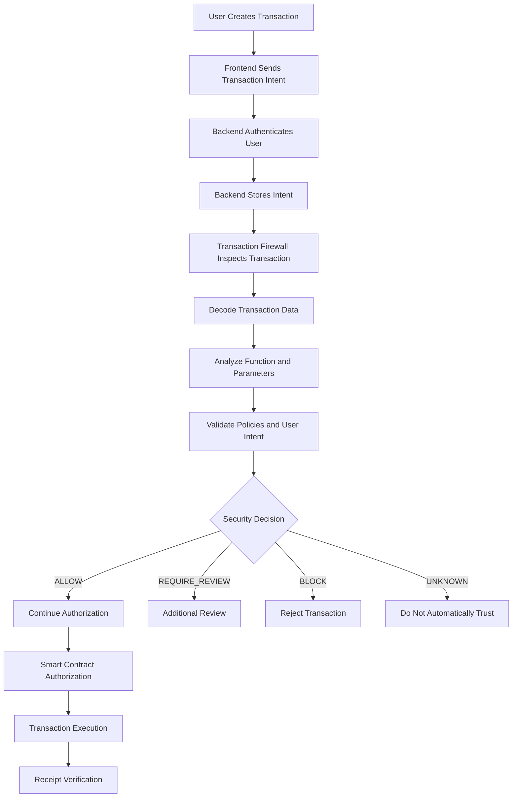

# SIGNOVA
### Pre-Transaction Blockchain Security & Authorization Platform

> **SIGNOVA is a security layer designed to protect blockchain users before they authorize and execute transactions. It analyzes transaction data, detects risky actions, validates user intent, and introduces policy-based authorization to reduce the risk of malicious or unintended transactions.**

---

## Overview

Blockchain transactions are irreversible. A user may unknowingly approve a malicious smart contract, grant unlimited token access, send funds to the wrong address, or interact with a transaction they do not fully understand.

Most users rely on wallet interfaces to approve transactions, but understanding the actual consequences of contract interactions can be difficult.

**SIGNOVA aims to add an intelligent security and authorization layer before a transaction is signed.**

Instead of immediately allowing a transaction to proceed, SIGNOVA evaluates the transaction, examines its function and parameters, compares it with the user's intended action, and produces a security decision.

The goal is to make blockchain transactions safer, more understandable, and more controlled.

---

## The Problem

Blockchain transactions present several security challenges:

- **Irreversible transactions:** Once confirmed, blockchain transactions generally cannot be reversed.
- **Malicious contract interactions:** Users may interact with contracts that behave maliciously.
- **Unlimited token approvals:** Users may accidentally grant a spender access to an unlimited amount of tokens.
- **Hidden transaction meaning:** Raw transaction data and function calls are difficult for ordinary users to understand.
- **Transaction manipulation:** The recipient, amount, spender, or transaction parameters may differ from what the user intended.
- **Lack of pre-signing validation:** Users may approve transactions without a separate security layer validating their intent.
- **Single-point authorization:** A user's wallet approval may be sufficient for a dangerous transaction, without additional policy or multi-signer controls.

SIGNOVA focuses on evaluating transactions **before authorization**, rather than relying only on users to detect problems after a transaction is submitted.

---

## Our Solution

SIGNOVA combines multiple security layers to inspect, evaluate, and control blockchain transactions.

### 1. Transaction Firewall

The transaction firewall inspects transaction data before it proceeds.

It can analyze:

- Native token transfers
- ERC-20 transfers
- ERC-20 approvals
- Function selectors
- Transaction calldata
- Recipient addresses
- Token contract addresses
- Spender addresses
- Approval amounts
- Transaction value
- User-defined transaction policies

The firewall classifies transaction behavior and evaluates whether it is acceptable under the configured security rules.

### 2. Transaction Intent Validation

SIGNOVA aims to ensure that a transaction matches what the user intended to perform.

For example, if a user intends to:

- Send 1 Quai to a particular address

SIGNOVA should verify the transaction against that intent.

If the actual transaction changes to:

- A different recipient
- A different amount
- A different contract
- An unexpected function
- A different spender

the transaction can be flagged for further review or blocked according to the security policy.

### 3. Risk Analysis

SIGNOVA evaluates transaction behavior using rule-based security checks.

Risky actions can include:

- Unlimited ERC-20 approvals
- Unknown or unsupported contract interactions
- Unverified token contracts
- Unexpected transaction values
- Unauthorized recipients
- Suspicious spender addresses
- Transactions that do not match user intent

### 4. Policy-Based Authorization

SIGNOVA is designed to support authorization policies that determine whether a transaction can proceed automatically or needs additional approval.

Depending on the risk and policy, a transaction may:

- Be permitted
- Require additional review
- Be rejected

### 5. Multisignature Security

The smart-contract authorization layer is intended to support additional approval requirements for sensitive transactions.

This can provide protection by requiring multiple authorized signers instead of relying on a single approval.

---

## How SIGNOVA Works

<b>Transaction Security Workflow</b>

### Step 1 — Transaction Creation

The user creates a blockchain transaction through the frontend.

The transaction contains information such as:

- Sender
- Recipient or contract address
- Amount
- Chain ID
- Transaction data
- Function call information

### Step 2 — Transaction Intent Submission

The frontend sends the transaction intent to the backend.

The backend authenticates the user and manages the submitted transaction intent.

### Step 3 — Firewall Inspection

The firewall receives the transaction details and analyzes the transaction.

It identifies the type of transaction and examines its data.

### Step 4 — Function Analysis

The firewall decodes transaction calldata to identify supported functions.

Examples include:

| Function | Purpose |
|---|---|
| `transfer()` | Transfers tokens to another address |
| `approve()` | Grants a spender permission to use tokens |
| `transferFrom()` | Transfers tokens using previously granted allowance |
| `balanceOf()` | Reads token balance |
| `allowance()` | Reads the approved spending allowance |

### Step 5 — Risk and Policy Evaluation

The firewall evaluates the transaction against security rules.

It checks whether the transaction is valid, supported, expected, and allowed by the configured policies.

### Step 6 — Security Decision

SIGNOVA produces a security decision.

| Decision | Meaning |
|---|---|
| `ALLOW` | Transaction passed the applicable checks |
| `REQUIRE_REVIEW` | Transaction needs additional review or approval |
| `BLOCK` | Transaction violates a security rule |
| `UNKNOWN` | Transaction could not be safely evaluated |

### Step 7 — Authorization

Transactions that are allowed to proceed enter the authorization process.

Sensitive transactions may require additional approval or multisignature authorization, depending on the implemented policy.

### Step 8 — Execution and Verification

After authorization and execution, the system can verify the transaction receipt to confirm the transaction outcome.

---

## Transaction Firewall

The SIGNOVA transaction firewall is one of the core security components of the platform.

Its purpose is to inspect transactions before they are trusted or authorized.

### Firewall Capabilities

- Transaction input validation
- Transaction classification
- Function selector identification
- ABI-based calldata decoding
- Native transfer analysis
- ERC-20 transaction analysis
- Approval amount analysis
- Unlimited approval detection
- Recipient validation
- Token contract validation
- Spender validation
- Intent matching
- Policy-based decision making
- Security explanations

### Supported Transaction Categories

#### Native Token Transfer

A transaction that transfers the blockchain's native currency from one address to another.

The firewall can examine:

- Sender
- Recipient
- Value
- Chain
- Transaction validity

#### ERC-20 Token Transfer

A token transfer using the ERC-20 `transfer()` function.

The firewall analyzes the function and its parameters, including the recipient and token amount.

#### ERC-20 Approval

An approval transaction uses `approve()` to authorize another address to spend tokens on behalf of the user.

SIGNOVA examines:

- Token contract
- Spender address
- Approval amount
- Whether the approval is unlimited
- Whether the spender is permitted by policy

Unlimited approvals can increase risk because the spender may be able to use the granted allowance without requiring the user to approve every individual transfer.

---

## Firewall Decision Engine

SIGNOVA uses deterministic, rule-based security evaluation.

Instead of trusting every transaction, the firewall evaluates the available transaction information and applies defined security rules.

### Decision Logic

| Condition | Result |
|---|---|
| Transaction is valid and satisfies the configured policy | `ALLOW` |
| Transaction needs additional confirmation or review | `REQUIRE_REVIEW` |
| Transaction violates a security rule | `BLOCK` |
| Transaction is unsupported, incomplete, or cannot be verified | `UNKNOWN` |

### Fail-Closed Security

SIGNOVA follows a fail-closed approach.

This means that if a transaction cannot be reliably inspected, the system should not automatically treat it as safe.

Examples:

- Unsupported function
- Invalid transaction data
- Missing transaction information
- Untrusted chain
- Unverified contract
- Firewall inspection failure

These conditions should not result in an automatic `ALLOW`.

This is important because a security system should not bypass its protection when it encounters something it cannot understand.

---

## ERC-20 Security Analysis

ERC-20 tokens commonly use smart-contract functions to transfer tokens and manage spending permissions.

SIGNOVA analyzes supported ERC-20 operations.

### `transfer()`

Transfers tokens from the caller to another address.

Security checks may include:

- Recipient validation
- Amount validation
- Transaction intent matching
- Policy validation

### `approve()`

Allows another address, known as the spender, to spend tokens up to a specified allowance.

SIGNOVA examines the spender and approval amount.

### Unlimited Approval Detection

An unlimited approval may allow a spender to use a very large amount of the user's tokens.

SIGNOVA can identify unlimited approval patterns and flag them according to the security policy.

This helps users avoid granting unnecessary spending permissions to contracts.

### `transferFrom()`

Allows an approved spender to transfer tokens from the token holder's account, subject to the allowance.

This function is important when analyzing token permissions and delegated spending.

---

## Transaction Intent Matching

Transaction intent matching is a key security mechanism.

The transaction that is finally inspected
